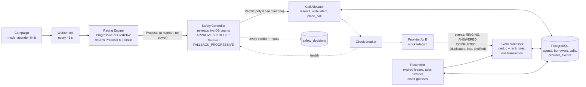
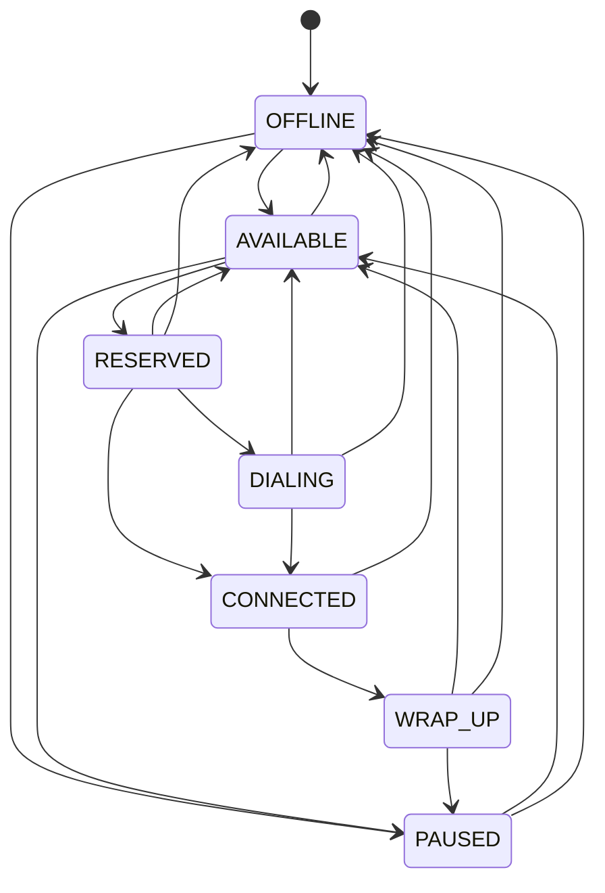
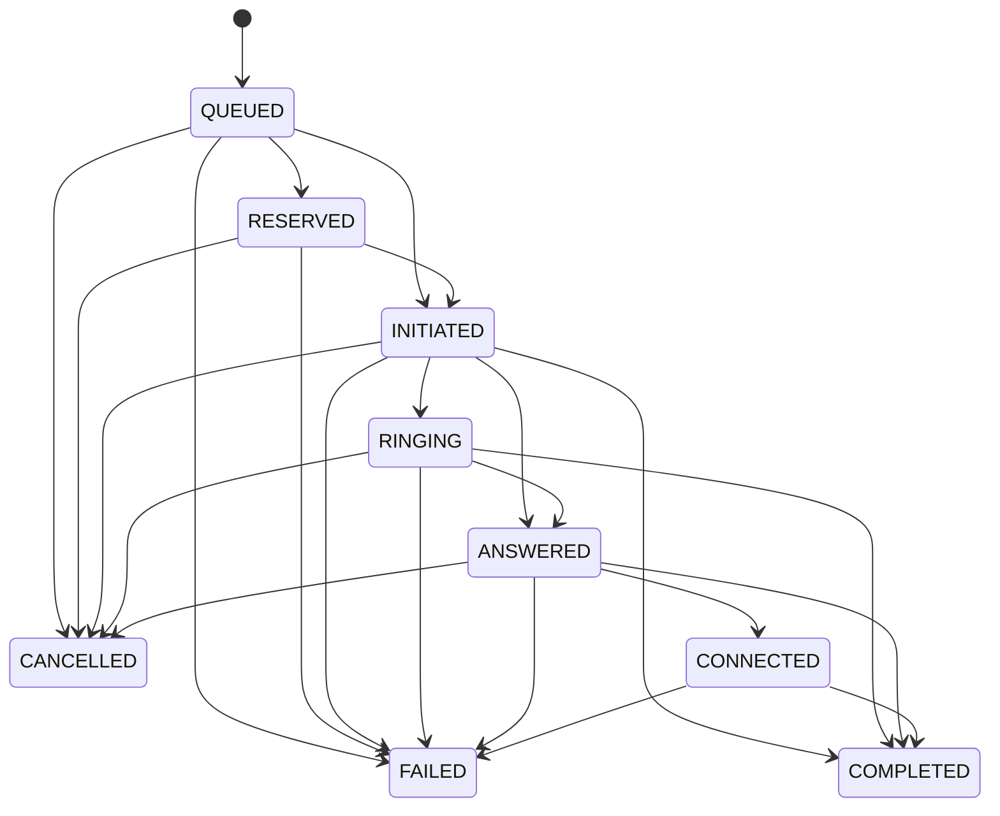

# SmartDialer prototype

A progressive + predictive dialer in which the pacing logic can only **propose** a number of calls and a
**Safety Controller** decides what is actually allowed. PostgreSQL is the only infrastructure.
Python 3.12, asyncio, asyncpg, pytest.

Where to read next: [docs/DECISIONS.md](docs/DECISIONS.md) (42 decisions: what / why / what it makes harder),
[docs/state-machines.md](docs/state-machines.md), [docs/SIMULATION_RESULTS.md](docs/SIMULATION_RESULTS.md),
and at the bottom of this file: [scale](#scale-what-breaks-first), [the final question](#the-final-question),
[what I am least sure about](#what-i-am-least-confident-about).

## Run it

```bash
docker compose up -d --wait          # PostgreSQL 16 on :5432 (creates `dialer` and `dialer_test`)
pip install -e ".[dev]"              # Python 3.12
pytest                               # 299 tests, about 4.5 minutes (real PostgreSQL, virtual clock)
pytest -m "not integration"          # unit tests only, no database needed (seconds)
python -m smartdialer.sim --quick    # 16 simulation runs in about a minute
python -m smartdialer.loadtest --agents 100 1000 10000 --workers 50 --seconds 10
```

Tests run against `dialer_test` and wipe it on every test; simulations use throwaway `*_sim` databases.
`reset_schema` refuses any database whose name does not end in `_test` / `_sim`, so the real `dialer`
database is never touched. Override with `DATABASE_URL` / `TEST_DATABASE_URL`.

More simulation commands:

```bash
python -m smartdialer.sim                               # the full A-D report at 100 agents (a few minutes)
python -m smartdialer.sim --all                         # plus E (provider outage) and F (40% of agents vanish)
python -m smartdialer.sim --scenarios B --epsilon 0.5   # STRESS: loosen the main safety rule, watch the backstops
```

Results are written to `docs/SIMULATION_RESULTS.md` / `docs/sim_results.json` and `docs/load_results.json`.
A run is reproducible exactly for a given `--seed` (D-37).

## Architecture



How a tick works, in order:

1. **Pacing** reads a snapshot (agents, calls in flight, recent answer statistics) and returns
   `Proposal(n, reason)`. It cannot dial anything; the proposal carries the arithmetic that produced `n`.
2. **Safety Controller** reads the live counts again from the database (not the pacer's snapshot), applies
   hard caps (free agents, live calls, provider health) and, for predictive proposals, the over-dial rule
   (D-30), then returns a verdict and a `Permit`. Every verdict is stored with its inputs.
3. **Allocator** accepts only a `Permit` the controller issued and remembers (D-21). There is no bypass flag.
   Progressive: reserve an agent *then* dial. Predictive: dial with no agent, reserve one atomically at the
   moment of ANSWERED; none free means an abandon (counted, budgeted).
4. **Events** from providers change state only through one path (rank rules, dedup key, one transaction).
   The **reconciler** uses the same path, with a status lookup instead of a guess.

"Why did the system decide to make this many calls right now?" is one query:

```sql
SELECT decided_at, proposed_n, approved_n, verdict, reason, inputs
FROM safety_decisions WHERE campaign_id = 1 ORDER BY decided_at DESC LIMIT 20;
```

`inputs->>'proposal_reason'` is the pacer's arithmetic (free agents, answer rate, ringing, credit horizon);
`reason` is what the controller did with it (for instance `reduced 17 -> 10: ...` or
`fallback to progressive: answer-rate shock ...`).

### Agent state machine

Generated from `src/smartdialer/states.py` (a test fails if this and the code disagree). Edge causes are in
[docs/state-machines.md](docs/state-machines.md).

<!-- agent-diagram -->


### Call state machine

Each state has a **rank** (QUEUED 0, RESERVED 1, INITIATED 2, RINGING 3, ANSWERED 4, CONNECTED 5, COMPLETED /
FAILED / CANCELLED 6). Provider events may only move a call to a strictly higher rank along a listed edge;
anything else is a late or duplicate event, stored as a fact and changing nothing. Terminal states are absorbing.
An *abandon* is FAILED with `end_reason = ABANDONED` (D-11), not a separate state.

<!-- call-diagram -->


## Layout

| Path | What |
|---|---|
| `src/smartdialer/states.py` | Agent + call state machines, transition tables, rank rules |
| `src/smartdialer/schema.sql` | Tables, partial unique indexes (one live call per borrower and per agent), CHECKs |
| `src/smartdialer/db.py`, `clock.py` | Connection helpers; injected clock (real / virtual) |
| `src/smartdialer/repo/` | Atomic reservation, CAS updates, provider-event dedup, snapshot and cohort statistics |
| `src/smartdialer/providers/` | `base.py` interface, `mock.py` Provider A (fast, ~2% failures, ordered) and B (slow, timeouts, duplicates, shuffled, outage switch), `behavior.py` borrower model, `breaker.py` circuit breaker |
| `src/smartdialer/dialer/` | `pacing.py` (Proposal, Progressive/PredictivePacer), `safety.py` (Safety Controller + Permit), `safetymath.py` (Wilson bound, binomial tail, EWMA, shock), `allocator.py` (reserve, intend, place, hang up excess), `callbacks.py` (provider events to agent/borrower), `lifecycle.py` (agent login/pause/vanish), `worker.py` (the tick loop), `reconciler.py` (expired leases, ask provider, settle) |
| `src/smartdialer/sim/` | Discrete-event simulator: `scenarios.py` (A-F), `runner.py`, `report.py`, CLI `python -m smartdialer.sim` |
| `src/smartdialer/loadtest.py` | Real-time load test: reservations/s and latency percentiles |
| `src/smartdialer/scheduler.py` | Deterministic virtual-time scheduler (no real sleeps) |
| `tests/unit` | State-machine, schema/doc drift, scheduler, provider, breaker, math and pacer tests (no DB) |
| `tests/integration` | 50-worker/10-agent race, CAS, event dedup/ordering, progressive end-to-end incl. failures, Safety Controller, crash recovery / outage / zombie worker / chaos soak, predictive, 100 to 60 agent drop, simulator reproducibility (real PostgreSQL, virtual clock) |

## What the simulation shows

100 agents, steady-state utilisation (after the first 3 minutes), progressive to predictive. Full tables,
pacing and safety detail per run: [docs/SIMULATION_RESULTS.md](docs/SIMULATION_RESULTS.md); reading and
caveats: D-42.

| Scenario | Provider A | Provider B |
|---|---|---|
| A: 20% answer, 120 s talk | 39.2 to 63.2% | 34.1 to 58.2% |
| B: 50%, 90 s | 54.4 to 63.2% | 48.4 to 58.1% |
| C: 70%, 180 s | 75.1 to 79.2% | 71.0 to 76.0% |
| D: answer rate and talk time change | 52.1 to 56.7% | 46.3 to 53.0% |
| E: provider outage | 53.9 to 62.0% | 47.4 to 57.1% |
| F: 40% of agents vanish | 53.8 to 62.1% | 47.2 to 54.3% |

7 abandons in 5,134 answered predictive calls (0.14%; limit 3%), all dead-air on the slow provider B;
progressive 0. The gain tracks idle time: biggest at low answer rates, small at 70%. Weak spots are listed
honestly below.

## Scale: what breaks first

Measured: the load test runs 50 workers doing reserve then release in real time. Result on a laptop
(Docker Desktop on Windows, one Python client): about 710 reservations/s, p99 56-63 ms, **flat from 100 to
10,000 agents**, no double booking. Snapshot cost per tick: 5.1 ms at 100 agents, 5.7 ms at 1,000, 7.8 ms at
10,000. Absolute numbers are a floor for this machine (the client is the limit); the shape is the finding (D-38).
Everything below that is not measured is reasoning from the schema and query plans, and says so.

**100 agents: nothing breaks.** One worker process ticking once a second; the snapshot is a few ms.

**1,000 agents: the per-tick snapshot and the window scans on `calls`.** Every tick, for every campaign, the
controller and pacer run aggregate queries (counts of agents by state, calls in flight, answer statistics over
the last minutes). These are O(agents) and O(recent calls) per tick, and they run before every decision. At
1,000 agents with ~35% answering and ~90 s talk the system starts ~15 calls/s, so the `calls` table grows by
~1.3M rows a day per campaign and the cohort windows (D-39) range-scan `initiated_at`. First fix, in order of
cost: (1) keep the windows on a partial/BRIN index over `initiated_at` and `answered_at` so a scan touches
only the window; (2) partition `calls` by day and archive finished partitions; (3) replace the per-tick
aggregates with counters the transaction that changes state also updates (`campaign_counts` row per campaign,
updated in the same transaction as the transition). That moves cost from "read O(agents) per tick" to "write
one row per event", which is fine until that row is hot (see 10,000).

**10,000 agents: write rate on hot rows, and status-lookup load.** At roughly 150 calls/s each call causes
~8 state changes plus a provider event insert, so ~1,500 to 2,000 writes/s on `calls`, `agents`,
`provider_events`: ordinary for PostgreSQL on real hardware, but three things concentrate:
- *A single campaign counter row* (fix 3 above) becomes a hot row. Shard the counter by agent or call id
  modulo 16 and sum on read.
- *Reservation* is still fine (`SKIP LOCKED` on a partial index; measured flat), but every worker that finds
  nothing AVAILABLE keeps polling. Fix: workers poll with backoff and are woken by `LISTEN/NOTIFY` on release,
  or the campaign is split across workers by hash of campaign id so only one scans.
- *Lease checks*: `connected_agents / lease_seconds` status queries per second to the provider (D-26): 10,000
  connected agents at 180 s is about 55 per second, fine; the provider's own rate limit is the thing to check.
  The reconciler scans `expired_calls` on a partial index, so its cost is proportional to what expired.
- *`provider_events` grows without bound* (every duplicate and late callback is kept as a fact). Partition by
  day, keep the dedup index on the live partitions only.

**What breaks first, in one sentence:** the per-tick aggregate reads (snapshot and cohort windows over `calls`),
not the reservation, because reservation was designed to be O(1) (partial index + `SKIP LOCKED`) while the
snapshot is O(agents) and O(recent calls) by construction.

**1,000 to 100,000 agents (the interview question):** one PostgreSQL primary stops being the right place for
the *hot path*. Shard by campaign (a campaign never needs to see another's agents, so `campaign_id` is a
natural shard key and the schema already carries it on every table); the Safety Controller's live count then
reads one shard. The abandon limit is per campaign, so the guarantee stays local. What would NOT shard simply
is a cross-campaign agent pool (an agent serving several campaigns); that needs a lease service in front of the
agent table and is the design I would argue about the most. Not "add more servers": the answer is to keep
reservation local to the shard that owns the agent, keep statistics as incrementally maintained counters, and
keep the provider-facing side horizontally scaled behind the breaker.

## The final question

*How would you build a SmartDialer that gets as much of the utilization benefit of predictive dialing as
possible while retaining the deterministic safety characteristics of progressive dialing?*

Separate **"how many calls would be nice"** from **"how many calls are allowed"**, and make the second one
arithmetic over live facts instead of a forecast.

1. **The pacer is only allowed to be optimistic, and has no power.** It estimates the answer rate and proposes
   `floor(free agents / p) - ringing`, counting agents about to finish wrap-up. A wrong guess costs
   utilisation, never safety, because it can only return a number.
2. **The controller is pessimistic and deterministic about the one thing that matters.** It never lets more
   calls ring than the agents we have could answer *with high probability*: the largest *n* such that
   P(answers > free agents) is at most 1%, from a binomial tail using the *upper* Wilson bound of the answer
   rate. That is a closed formula over counts read from the database in that moment, so the same inputs always
   give the same verdict, and it is logged with its inputs. Progressive dialing is the special case p = 1.
3. **Fail closed to progressive, not to nothing.** When the estimate cannot be trusted (provider breaker open,
   answer-rate shock, abandon budget nearly spent) the controller returns the *progressive* number: reserve an
   agent before dialing, zero abandon risk. Predictive is a privilege that is withdrawn automatically and
   returns when evidence returns.
4. **Make the unsafe state unrepresentable.** The allocator accepts only a `Permit` the controller minted;
   agents and borrowers are reserved atomically in the database (`SKIP LOCKED`); a partial unique index makes a
   second live call per borrower impossible; abandons are counted against a budget the controller reads each tick;
   still-ringing excess calls are cut when agents vanish, but only after asking the provider whether the borrower
   already answered.

The measured result: roughly 4-24 points more utilisation than progressive, depending on how much idle time
progressive wastes, with 0.14% abandons. The honest cost is the margin: loosening the 1% tail rule 50x would
add 3-4 more points at still under 1% abandons, which is the knob a business would argue about.

## What I am least confident about

- **The answer-rate estimate lags ~35 s** (D-39). Cohort-by-dial-time fixed a real bias but delays noticing a
  change. In scenario D the controller spent ~45% of ticks in shock-driven fallback. The abandon budget is the
  fast backstop, and I would rather be slow-and-correct than fast-and-wrong, but it is the weakest link.
- **Dead air on slow providers is reduced, not eliminated** (D-40). Between "provider says still ringing" and
  the cancel landing, the borrower can answer. Closing it needs an atomic cancel-if-unanswered from the
  provider. 7 of 5,134 in simulation, all provider B.
- **Borrowers answer independently in the simulator** and mock providers are mine; there is no time-of-day
  correlation, one seed per cell, 100 agents. Real telecom is messier.
- **Small teams (under ~5 agents) get no over-dial**: the tail rule is right to be strict there, but it means
  predictive does nothing for them.
- **A provider outage loses capacity** (E): we do not guess about calls we cannot verify (D-25).
- **Cross-campaign agent pools** are not modelled; the agent belongs to one campaign (see scale).
- **Load test** measures reservation and snapshot, not the full tick under production network latency.

What I would do with another week: a CUSUM shock detector instead of two windows; a talk-time model so agents
about to finish count as capacity; counter rows instead of per-tick aggregates; a real provider contract test
suite; and run multiple seeds per cell for confidence intervals.
