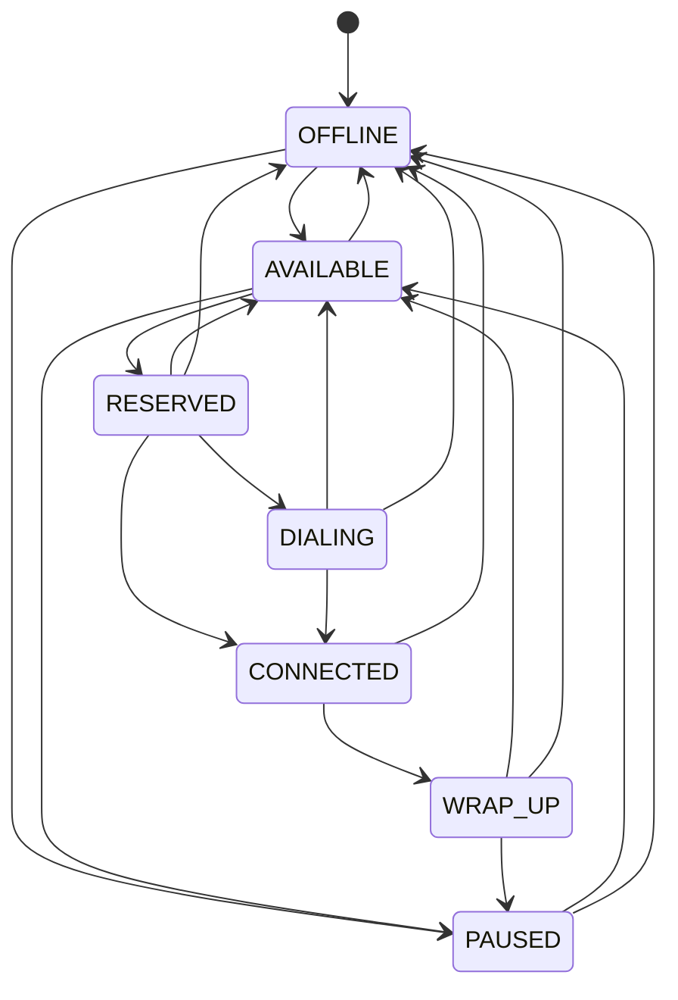
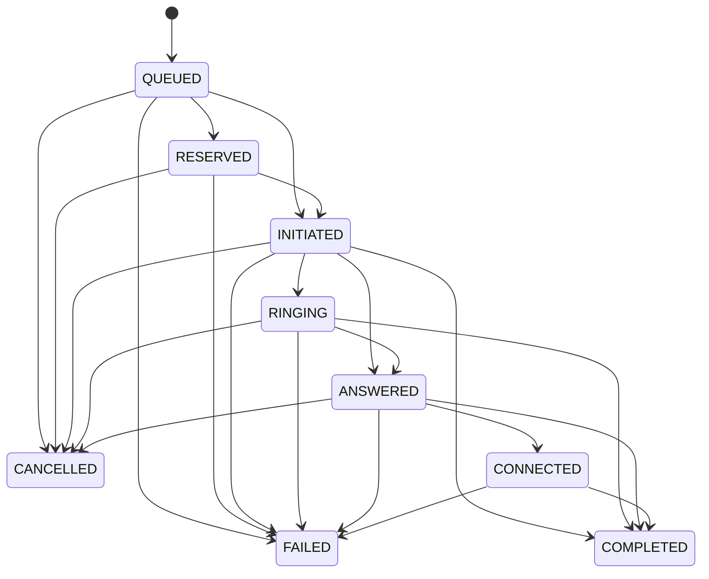

# State machines

Both diagrams are generated from `src/smartdialer/states.py`
(`python -m smartdialer.states`) and `tests/unit/test_schema_enums.py` fails if this file
and the code disagree. The code is the source of truth; this is the picture of it.

## Agent state machine

<!-- agent-diagram -->

| Edge | Cause |
|---|---|
| AVAILABLE → RESERVED | Dialer claims the agent: one atomic `UPDATE … WHERE id = (SELECT … FOR UPDATE SKIP LOCKED LIMIT 1)` |
| RESERVED → DIALING | Provider accepted `place_call` (progressive) |
| DIALING → CONNECTED | Borrower answered and was bridged |
| RESERVED / DIALING → AVAILABLE | Call failed, was cancelled, or the lease expired: agent released |
| any busy state → OFFLINE | Agent disappeared (during setup or mid-call) |
| CONNECTED → WRAP_UP → AVAILABLE | Call ended; wrap-up timer elapsed |
| AVAILABLE / WRAP_UP → PAUSED | Agent break. A *busy* agent's break request is applied after wrap-up (D-05) |

In **predictive** mode an agent is not reserved before dialing: AVAILABLE → RESERVED happens
atomically at the moment a call is ANSWERED, and the agent goes RESERVED → CONNECTED (there
is no dialing to do: the borrower is already on the line). The repository performs
reservation, call → CONNECTED and the agent move in one transaction. If no agent is free the
call becomes FAILED / `ABANDONED`.

## Call state machine

Each state has a **rank** (QUEUED 0 · RESERVED 1 · INITIATED 2 · RINGING 3 · ANSWERED 4 ·
CONNECTED 5 · COMPLETED / FAILED / CANCELLED 6). Provider events may only move a call to a
strictly higher rank along a listed edge; anything else is a late or duplicate event that is
stored as a fact and changes nothing. Terminal states are absorbing.

<!-- call-diagram -->

| Incoming event vs. current state | Decision | Effect |
|---|---|---|
| Same state again (`ANSWERED`, `ANSWERED`) | DUPLICATE | none |
| Lower or equal rank (`RINGING` after `ANSWERED`) | STALE | recorded, no state change |
| Anything after a terminal state | STALE | recorded (e.g. late `ANSWERED` still counts for answer-rate stats) |
| Higher rank, listed edge | APPLY | state moves, `version` bumps |
| Higher rank, not an edge (`QUEUED → CONNECTED`) | ILLEGAL | recorded, logged, no state change |

Abandons are not a separate state: an abandoned call is `FAILED` with
`end_reason = 'ABANDONED'` and `answered_at` set (D-11).
